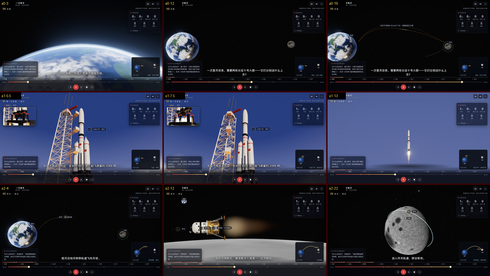

# 两次发射、一次登月

浏览器里的实时 3D 交互式科普作品：用约 5 分钟、10 幕动画，讲清楚中国载人月球探测工程的"两次发射、环月对接"方案（俗称"两次发射、一次登月"）——两次发射各送什么上去、三名航天员为什么只有两人登月、飞船和着陆器在月球轨道"握手"几次、航天员怎样从月面回到地球。

GLM5.4，约1.72亿token，用时7小时14分。缓存命中的上下文约 1.66 亿，未缓存的输入约 442 万，输出约 115 万。

- 真 3D：Three.js 实时渲染，全程可拖拽旋转、缩放，可慢放、倒放，不是视频或预渲染图片
- 纯前端：模型与贴图全部由代码生成，不依赖外部素材
- 事实克制：名称与数字只取自公开报道，未公布的数据不出现；界面固定标注"数据来自公开报道，造型与轨道为示意"




## 运行

需要 Node.js 20.19 或更高版本。

```bash
npm install
npm run dev        # 开发服务器，打开终端里给出的地址
```

构建与部署：

```bash
npm run build      # 产物在 dist/，可放到任意静态托管（相对路径，支持子目录）
npm run preview    # 本地预览构建产物
npm run typecheck  # TypeScript 类型检查
```

## 操作

| 操作           | 鼠标 / 触屏                                                                                         | 键盘                                       |
| ------------ | ----------------------------------------------------------------------------------------------- | ---------------------------------------- |
| 开始 / 暂停      | "开始播放"按钮；播放键                                                                                    | 空格 或 回车                                  |
| 上一幕 / 下一幕    | ‹ › 按钮；点击底部分幕时间轴                                                                                | ← / →                                    |
| 幕内进度         | 拖动或点击进度条                                                                                        | 进度条获得焦点（Tab）后用方向键步进 2 秒，按住 Shift 步进 10 秒 |
| 慢放 / 倒放      | 速度按钮循环：1× → 0.5× → 0.25× → 倒放 0.5× → 倒放 1×                                                      | —                                        |
| 重播           | ↺ 按钮                                                                                            | R                                        |
| 自由视角         | 在画面上拖拽旋转，滚轮或双指缩放；停手几秒后自动回到导演机位                                                                  | —                                        |
| 回到导演机位       | 自由视角时出现的按钮                                                                                      | —                                        |
| 部件信息         | 点击飞行器旁的 "+" 热点：逃逸塔、返回舱、服务舱、推进舱、登月舱、着陆腿等。标签会自动找空位：先在热点右侧，不行换到左侧、上方或下方；实在放不下，或部件被飞行器挡住时，热点和标签一起隐藏 | —                                        |
| 字幕 / 声音 / 全屏 | 右上角三个按钮                                                                                         | C / M / F                                |
| 片尾路线图        | 点击任一节点回看该幕                                                                                      | —                                        |

系统开启"减少动态效果"时，转场不再淡入淡出，再入镜头不再抖动。

## 分镜（10 幕，共 5 分 04 秒）

| 幕   | 名称         | 时长   | 画面                                            | 讲清的事                         |
| --- | ---------- | ---- | --------------------------------------------- | ---------------------------- |
| 0   | 序章         | 22 秒 | 从中国上空的地球特写拉远到地月同框，三条轨道线依次亮起                   | 目标是 2030 年前；一次登月任务需要两枚长征十号   |
| 1   | 第一次发射 · 揽月 | 32 秒 | 文昌塔架，点火升空（慢镜头，画中画切入发动机特写），助推器分离、级间分离、整流罩分离    | 长征十号关键参数；这一发送的是无人着陆器揽月       |
| 2   | 奔月 · 停泊    | 28 秒 | 沿地月转移轨道飞向月球，推进舱点火近月制动，进入环月轨道                  | 揽月先到，在环月轨道等待                 |
| 3   | 第二次发射 · 梦舟 | 26 秒 | 再次点火升空，顶部是梦舟与逃逸塔                              | 这一发送的是载有 3 名航天员的梦舟；由飞船承担逃逸救生 |
| 4   | 月轨握手       | 34 秒 | 逼近、缓靠、锁紧（慢镜头画中画），剖面显示 2 人进入揽月、1 人留守           | 第 1 次对接；2 人登月、1 人留守          |
| 5   | 分离 · 落月    | 30 秒 | 揽月分离、调头，推进舱点火下降，伴飞机位看月面越来越近，着陆腿触月扬起月尘（慢镜头画中画） | 推进舱负责下降主减速；软着陆               |
| 6   | 月面作业       | 36 秒 | 黑色天空中悬挂着地球；穿"望宇"登月服出舱，驾驶"探索"月球车采样             | 揽月是月面的生活、能源与数据中心             |
| 7   | 起飞 · 再握手   | 32 秒 | 登月舱点火起飞（慢镜头画中画），推进舱留在月面；第 2 次对接，剖面显示样品转移      | 第 2 次对接；3 人会合                |
| 8   | 归途         | 34 秒 | 返回舱与服务舱分离，再入时包裹等离子光焰，开伞，海上溅落                  | 返回舱承担再入大气层与着陆，可重复使用          |
| 9   | 尾声         | 30 秒 | 可点击的全流程路线图、研制进展、"2030 年前"目标                   | 方案亮点；工程进展                    |

每幕左下角的"为什么这样设计"取自方案的亮点：量力而行、轻装登月、分工明确、安全兜底、技术传承、系列化。

## 结构

- `src/core/`：时间线（分幕、字幕、事件时刻）、任务状态（任意时刻的发射与对接计数、每名航天员在哪、样品在哪）、缓动函数
- `src/app/`：渲染循环与泛光后期、相机（导演机位 + 自由视角 + 慢镜头画中画）、自适应分辨率
- `src/stages/`：五个舞台——地月全景、发射场、环月轨道、月面、再入，各用各的尺度
- `src/art/`：程序化资产——长征十号、梦舟、揽月、登月服、月球车、国旗、降落伞，地球着色器，月面地形与月壤纹理
- `src/ui/`：任务状态面板、分幕时间轴与进度条、地月小地图、热点标签的自动排版与信息卡、片尾路线图
- `src/audio/`：WebAudio 程序化合成的引擎声、风声、提示音与氛围音乐
- `src/data/facts.ts`：热点信息卡文字，取自事实底稿

所有动画都是全局时间 t 的函数，不依赖上一帧的累积，所以才能任意拖动、慢放和倒放。

## 事实来源

界面上的名称与数字整理自中国载人航天工程办公室、国家航天局、新华社、央视的公开报道（截至 2026 年 11 月），篇目见活动提供的 `prompt.md` 第二节。用到的事实有：

- 长征十号：全长约 92.5 米，起飞质量约 2189 吨，起飞推力约 2678 吨，地月转移轨道运载能力不低于 27 吨，从海南文昌航天发射场发射
- 梦舟：返回舱 + 服务舱两舱构型，发射段顶部有逃逸塔，登月任务可搭载 3 名航天员，近地任务可搭载 7 人，返回舱可重复使用
- 揽月：登月舱 + 推进舱，可搭载 2 名航天员往返，可携带月球车和科学载荷
- 登月服"望宇"、载人月球车"探索"
- 第二宇宙速度 11.2 千米/秒；地月平均距离 384,400 千米
- 研制进展：2025 年 6 月 17 日、2025 年 8 月 6 日、2026 年 2 月 11 日、2026 年 7 月 10 日四个节点

## "示意"声明

- 所有飞行器、发射场、设备的外观都是示意建模，不是工程图纸。
- 轨道形状、地月距离、月面尺度、环月轨道高度都是示意，画面里标注了"画面距离为示意"。地月距离太大，作品按幕拆成五个舞台，各用各的比例。
- 两次发射的间隔、地月转移飞行时长、月面驻留时长、着陆区位置等官方未公布的数据，作品里没有出现。全片约 5 分钟是压缩后的叙事节奏，不代表真实时序。
- 月面场景里的五星红旗是示意画面，按国家标准的长宽比 3:2 和五星位置绘制。
- 再入等离子体、月尘、尾焰、声音都是艺术化表现。
